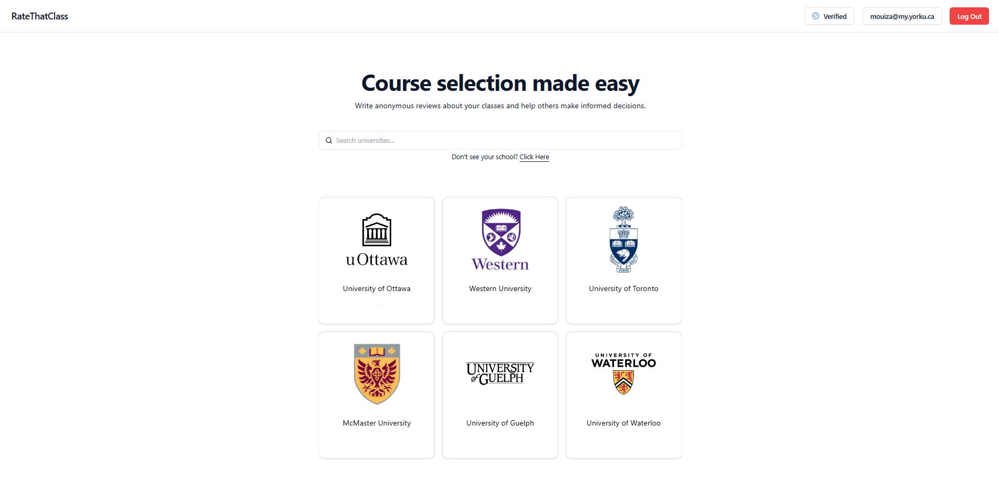

<div align="center">
    
</div>
<h1 align="center">
    Rate That Class
</h1>

A web application that allows users to anonymously create course reviews for their respective post-secondary schools and ease their struggles within the course selection process.

Try it now: [https://ratethatclass.com/](https://ratethatclass.com/)

# Overview

Students can read and write anonymous reviews of courses at their post-secondary schools. Reviews are organized by school, department, course, and professor, and users can add any that are missing. Anyone can post without an account, or sign up with any email. Reviews from verified student emails get a student badge.



# Features

- **Anonymous Course Reviews**: Rate a course and share insights about its content, the professor, and advice for future students, plus grade, workload, textbook usage, and evaluation methods
- **Four Rating Categories**: Overall Quality, Easiness, Interest Level, and Usefulness, each on a 1-5 scale
- **Flexible Accounts**: Post anonymously or sign up with any email; verified student emails get a student badge
- **Browsing and Filtering**: Browse by university, department, course, and professor, then filter by term and delivery method and sort the results
- **Automated Course Data**: Course catalogs scraped and kept up to date for major Canadian universities
- **Community Voting**: Upvote and downvote reviews to surface the most helpful ones
- **Review Management**: View and delete your own reviews from your profile
- **Reporting and Moderation**: Report inappropriate content; admins handle reports, ban users, and manage admin accounts from a dashboard
- **Mobile-Friendly**: Works on desktop and mobile
- **SEO**: Server-side rendering and a dynamically generated sitemap

# Project Structure

```
rate-that-class/
├── client/                 # Next.js frontend application
│   ├── src/
│   │   ├── app/           # Next.js app router pages
│   │   │   ├── adsense/   # Google AdSense components
│   │   │   ├── auth/      # Authentication forms
│   │   │   ├── common/    # Shared components
│   │   │   ├── dialogs/   # Modal and dialog components
│   │   │   ├── display/   # Data display components
│   │   │   ├── forms/     # Form components and steps
│   │   │   └── ui/        # Base UI components (shadcn/ui)
│   │   ├── contexts/      # React context providers
│   │   ├── firebase/      # Firebase client configuration
│   │   ├── hooks/         # Custom React hooks
│   │   ├── lib/           # Utility functions and constants
│   │   ├── requests/      # API request functions
│   │   └── types/         # TypeScript type definitions
│   ├── public/            # Static assets
│   ├── .next/             # Next.js build output
│   ├── next.config.ts
│   ├── tailwind.config.ts
│   ├── postcss.config.mjs
│   ├── tsconfig.json
│   ├── components.json    # shadcn/ui components configuration
│   └── package.json
├── server/                # Express.js backend API server
│   ├── src/
│   │   ├── routes/        # API endpoint route definitions
│   │   ├── controllers/   # Request handlers and business logic
│   │   ├── services/      # Business logic and data processing
│   │   ├── repositories/  # Database access layer
│   │   ├── validators/    # Request validation schemas
│   │   ├── db/           # Database connection and configuration
│   │   ├── helpers.ts    # Utility functions
│   │   ├── types.ts
│   │   └── index.ts      # Express server entry point
│   ├── middleware/        # Authentication middleware
│   ├── firebase/          # Firebase admin configuration
│   └── package.json
├── init-db/
│   └── init-db.sql        # Database schema and initial data for Docker
├── scraper/               # University data collection tools
│   ├── scrapers/          # Individual university scrapers
│   │   ├── base_scraper.py    # Base scraper class
│   │   └── *_scraper.py       # University-specific scrapers
│   ├── scraped_data/      # Storage for scraped university data
│   │   └── *_data.json        # University-specific scraped data
│   ├── logs/              # Scraper execution logs
│   │   └── scraper_YYYYMMDD_HHMMSS.log  # e.g. scraper_20250604_200750.log
│   ├── database.py        # Database operations and models
│   ├── logger.py          # Logging configuration
│   ├── utils.py           # Shared utility functions
│   └── main.py           # Scraper CLI entrypoint
├── docker-compose.yml     # Multi-container Docker setup
└── README.md              # Project documentation
```

# Tech Stack

## Frontend

- **Framework**: Next.js 15.1.3 (React)
- **Styling**: Tailwind CSS + shadcn/ui components
- **Authentication**: Firebase Auth
- **Language**: TypeScript

## Backend

- **Runtime**: Node.js
- **Framework**: Express.js
- **Database**: PostgreSQL
- **Authentication**: Firebase Admin SDK
- **Language**: TypeScript

## Scraper

- **Language**: Python
- **Web Scraping**: Selenium WebDriver + BeautifulSoup4
- **Data Storage**: JSON files, imported into PostgreSQL (psycopg2) in one transaction per university
- **Browser Automation**: Headless Chrome WebDriver

## Infrastructure

- **Frontend Hosting**: [Vercel](https://vercel.com/)
- **Backend Hosting**: [Render](https://render.com/)
- **Database Hosting**: [Supabase](https://supabase.com/)
- **Image Hosting**: [Cloudinary](https://cloudinary.com/)
- **Authentication**: [Firebase Auth](https://firebase.google.com/docs/auth)
- **Containerization**: [Docker](https://www.docker.com/)

# Getting Started

This application is designed to run with Firebase and cannot be run locally due to Firebase auth dependencies.

## Prerequisites

- Running Docker Daemon
- Firebase Project with auth enabled

## Installing

1. If you don't have docker, you can find the installation instructions [here](https://docs.docker.com/get-started/get-docker/)

2. Install the project by cloning this repository: `git clone git@github.com:mouizahmed/ratethatclass.git`

3. Configure Firebase:

   **Client-side Configuration (Frontend):**

   - Go to [Firebase Console](https://console.firebase.google.com/)
   - Create a new project or use an existing one
   - Enable Authentication in your Firebase project
   - Go to Project Settings > General and copy your web app configuration
   - In `docker-compose.yml`, replace the client Firebase environment variables:
     - `NEXT_PUBLIC_FIREBASE_API_KEY`
     - `NEXT_PUBLIC_FIREBASE_AUTH_DOMAIN`
     - `NEXT_PUBLIC_FIREBASE_PROJECT_ID`
     - `NEXT_PUBLIC_FIREBASE_STORAGE_BUCKET`
     - `NEXT_PUBLIC_FIREBASE_MESSAGING_SENDER_ID`
     - `NEXT_PUBLIC_FIREBASE_APP_ID`

   **Server-side Configuration (Firebase Admin SDK):**

   - Go to Project Settings > Service Accounts
   - Click "Generate new private key" to download a JSON file
   - Extract the following values from the JSON file and add them to `docker-compose.yml`:
     - `CLIENT_EMAIL` (from `client_email`)
     - `CLIENT_ID` (from `client_id`)
     - `CLIENT_X509_CERT_URL` (from `client_x509_cert_url`)
     - `PRIVATE_KEY` (from `private_key` - keep the quotes and newlines)
     - `PRIVATE_KEY_ID` (from `private_key_id`)
     - `PROJECT_ID` (from `project_id`)

4. Start the application:

   ```bash
   # Build the containers first
   docker-compose build

   # Start the application
   docker-compose up -d
   ```

## Scraper Usage

The scraper can be built and run using Docker. Here are the available commands:

### Required Environment Variables

The scraper requires the following environment variables to be set in a `.env` file:

```
DB_NAME=
DB_USER=
DB_PASSWORD=
DB_HOST=
DB_PORT=
```

To use the database from `docker-compose.yml`, use the values from its `postgres` service. `DB_HOST` is the service name, which works because the commands below join the compose network:

```
DB_NAME=ratethatclass
DB_USER=postgres
DB_PASSWORD=postgres
DB_HOST=postgres
DB_PORT=5432
```

For a hosted database (e.g. Supabase), use its connection details instead and drop the `--network` flag below.

Run these commands from the `scraper/` directory, with the `.env` file there too:

1. Build the scraper:

   ```bash
   docker build -t course-reviews-scraper .
   ```

2. Start the database if it isn't already running (`docker-compose up -d postgres` from the repo root), then run one of:

   ```bash
   # Scrape and store data in database
   docker run --network ratethatclass_default -v ${PWD}/scraped_data:/app/scraped_data -v ${PWD}/logs:/app/logs --env-file .env course-reviews-scraper scrape-and-store

   # Scrape only (saves to JSON files)
   docker run -v ${PWD}/scraped_data:/app/scraped_data -v ${PWD}/logs:/app/logs --env-file .env course-reviews-scraper scrape-only

   # Import existing JSON files into database
   docker run --network ratethatclass_default -v ${PWD}/scraped_data:/app/scraped_data -v ${PWD}/logs:/app/logs --env-file .env course-reviews-scraper store-json
   ```

   Chrome runs headless by default. When running outside Docker, add `--headed` to watch the browser (e.g. `python main.py scrape-only --headed`).

# License

[AGPL](https://github.com/mouizahmed/ratethatclass/blob/master/LICENSE)
